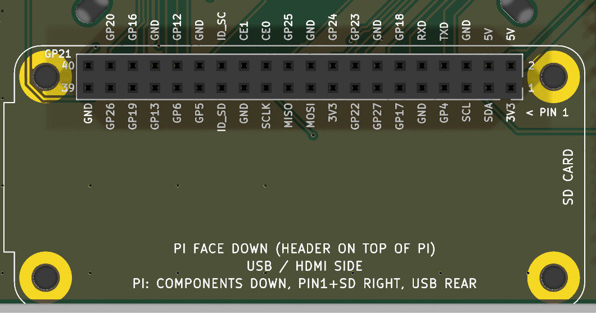
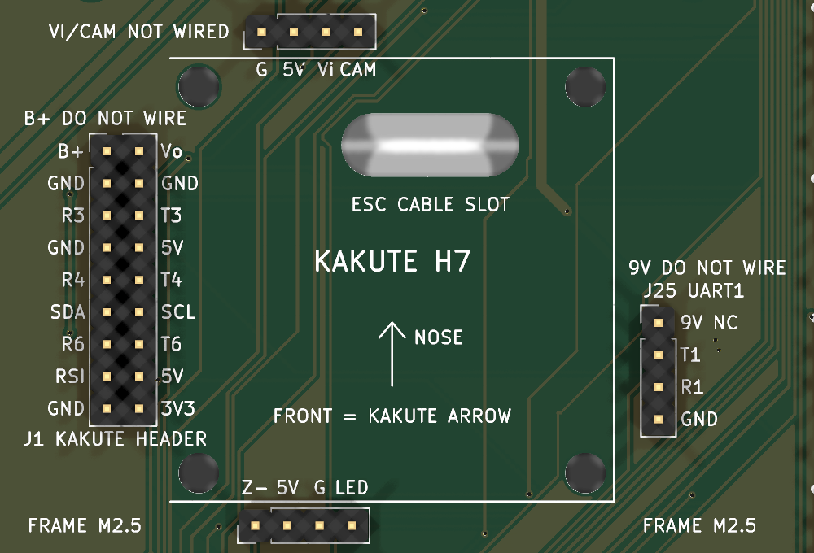
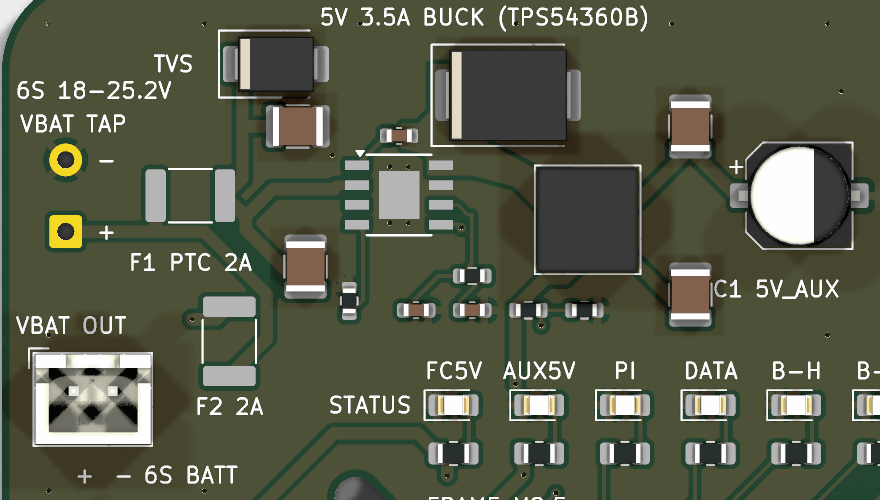

# Assembly

## What JLCPCB fits

Only the SMD parts (U2, L1, D1-D9, F1, F2, C1-C8, R1-R11): 32 parts on 21 BOM lines.
Every through-hole part is hand-soldered and left out of the BOM/CPL (it still shows in the 3D view).

## Parts to buy and hand-solder

All parts are 2.54 mm pitch unless stated. LCSC numbers were in stock at JLC/LCSC on 2026-10-28.

| Qty | Part | LCSC | Where |
|---|---|---|---|
| 1 | 2x20 female socket, 8.5 mm tall | C5124634 | U1 (Pi) |
| 1 | 2x9 male header | C42372517 | J1 (Kakute) |
| 1 | 2x8 male header | C32713281 | J7 (Pi GPIO) |
| 1 | 1x7 male header | C32713273 | J18 (Pi SPI) |
| 3 | 1x6 male header | C32713272 | J8, J11, J17 |
| 6 | 1x4 male header | C32713270 | J23, J24, J25, J6, J9, J12 |
| 1 | 1x3 male header | C32713269 | J10 |
| 1 | 1x2 male header | C32713268 | J13 |
| 1 | 2-pin JST-XH compatible, vertical, 2.5 mm | C2908600 | J20 (VBAT OUT) |
| - | battery wires, 18 AWG | - | J3 pads |

You can snap long strips of male header to length instead of buying each size.

Solder U1 square and flat (it is the 8.5 mm socket): tack one pin at each end, check it, then solder the rest.

## Pi Zero W

The Pi plugs onto U1 **face down**. Its 2x20 male header is soldered on the Pi's top (component) side with the pins pointing up, as on a Pi Zero WH. Turn the Pi over and push it onto the socket so that:

- pin 1 (3V3, the square pad on the carrier, "< PIN 1") is at the **right** end of the socket, on the row nearer the **rear** edge (the 5V row is nearer the middle of the board),
- the Pi's SD card is at the right, and its USB/HDMI edge is at the rear of the carrier.

Every pin is named on the silkscreen.

!!! warning
    Do not fit the Pi face up. That mirrors the pinout and puts 3V3/5V on the wrong pins.

Clearance: the Pi's component face sits about 11 mm above the carrier (8.5 mm socket + ~2.5 mm header spacer). The tallest Pi parts (mini-HDMI, ~3.2 mm) leave ~7.8 mm, and there are no carrier parts under the Pi outline. Pi standoffs, if you use them, need to match that gap (measure it; about 11 mm).

## Kakute harness (J1, J23, J24, J25)

The Kakute's pads are flat solder pads, so the Kakute does not plug straight onto the carrier. Make one short harness instead:

1. Solder thin silicone wires (26-28 AWG) to the Kakute pads.
2. Crimp the other ends into 2.54 mm Dupont housings that match the carrier headers pin for pin:
    - **J1 (2x9)**: the Kakute's left pad strip. Outer column = B+, GND, R3, GND, R4, SDA, R6, RSI, GND; inner column = Vo, GND, T3, 5V, T4, SCL, T6, 5V, 3V3.
      **B+ and Vo: do not wire** (they have no net on the carrier).
    - **J23 (1x4)**: Kakute top pads G, 5V, Vi, CAM. **Vi and CAM: do not wire.**
    - **J24 (1x4)**: Kakute bottom pads Z-, 5V, G, LED.
    - **J25 (1x4)**: Kakute 6-pin JST 9V, T1, R1, G. **9V: do not wire** (pin 1 has no net).
3. Keep the wires slack so the Kakute stays soft-mounted on its grommets.

Pin 1 of each header is the square pad, and every pin is labelled on the silkscreen.

## Power

- Battery: 6S Li-ion / LiPo only, 18-25.2 V (22.2 V nominal), into J3.
- J3 wire: 18 AWG. The worst case is about 3.1 A (the 5 V buck at 3.5 A out from a flat 18 V pack draws 1.1 A, plus 2 A on J20 VBAT OUT).
- F1 (2 A PTC) feeds the 5 V regulator (U2). F2 (2 A PTC) feeds J20 VBAT OUT.
- There are no 12 V or 9 V outputs on this board (they were removed to cut assembly cost).

## Mechanical

- Frame: 4x M2.5 slots on a 48.5 mm square, standoffs at least 10 mm. Trim leads to 1.5 mm or less underneath.
- Pi Zero: face down on the standard-height 2x20 socket (8.5 mm); see [Pi Zero W](#pi-zero-w).

## First power-up

Use a bench supply at about 20 V, current limited, with nothing plugged in.

1. Check 5V_AUX on J6/J13: it should read 5.0-5.1 V, and the AUX5V LED should be on.
2. Only then plug in the Kakute harness, the Pi and the peripherals.

## Not yet confirmed

- Kakute pad pitch (check it against the [1:1 template](files/maame_carrier_plate_template_1to1.pdf))
- Kakute 5 V current limit
- SiK and TF-Luna lead order
- M10Q lead colours
