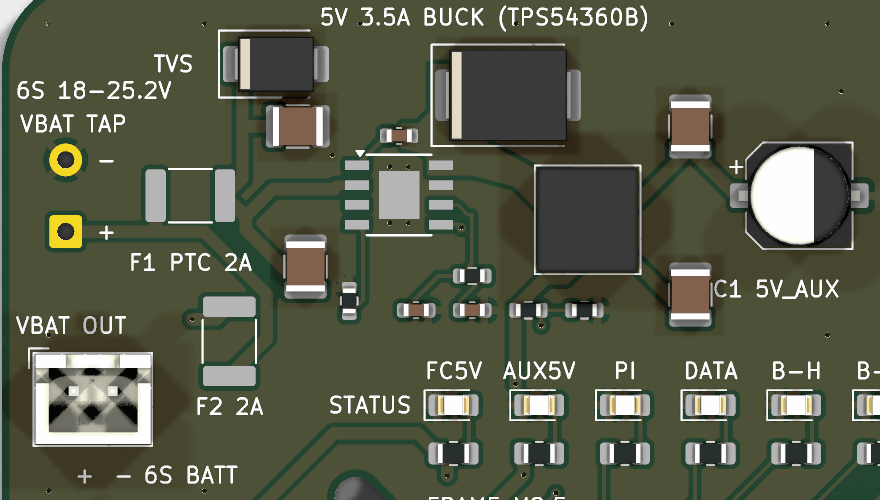
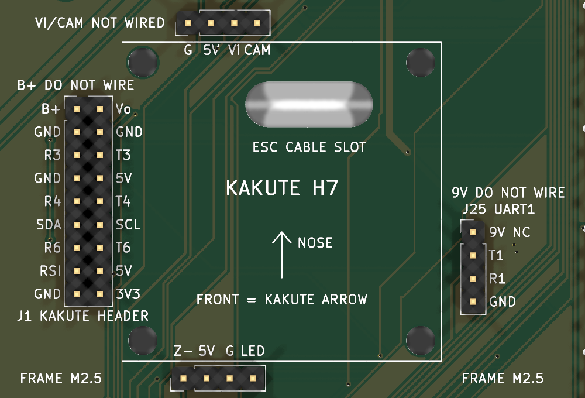
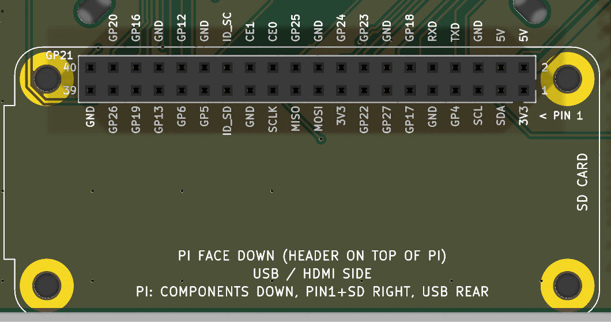

# Board tour

## Top

The nose of the drone points up in this view (the arrow in the Kakute outline). Every pin is named on the silkscreen, and pin 1 of each header is the square pad.

## Bottom

The bottom silkscreen carries a connection legend for the whole board.

## Power section

| Ref | What it is |
|---|---|
| J3 | VBAT TAP: battery pads for 18 AWG wire, 6S 18-25.2 V |
| F1 | 2 A PTC fuse feeding the 5 V buck |
| D9 | SMBJ30A TVS across the battery input |
| U2, L1, D8 | TPS54360B 5 V 3.5 A buck, 8.2 uH inductor, Schottky diode |
| C1 | 470 uF bulk capacitor on 5V_AUX |
| F2, J20 | 2 A PTC fuse and the VBAT OUT JST-XH connector (pin 1 = +) |

Two 5 V rails appear on the headers:

- **5V_AUX** comes from the U2 buck on this board.
- **5V_FC** is the Kakute's own 5 V, brought in through the harness.

## Status LEDs

The LEDs sit in a row under the buck, labelled on the silkscreen:

| Label | Meaning |
|---|---|
| FC5V | 5V_FC present (Kakute 5 V) |
| AUX5V | 5V_AUX present (U2 buck) |
| PI | Pi GPIO16 |
| DATA | Pi GPIO20 |
| B-H, B-M, B-L | battery level, Pi GPIO19 / GPIO21 / GPIO18 |

## Kakute H7 area

The Kakute's pads are flat solder pads, so it connects through a harness to four headers that copy its pad layout 1:1. See [Assembly: Kakute harness](assembly.md#kakute-harness-j1-j23-j24-j25).

| Ref | Kakute pads | Do not wire |
|---|---|---|
| J1 (2x9) | left pad strip | B+, Vo |
| J23 (1x4) | top pads G, 5V, Vi, CAM | Vi, CAM |
| J24 (1x4) | bottom pads Z-, 5V, G, LED | - |
| J25 (1x4) | 6-pin JST: 9V, T1, R1, G (UART1) | 9V |

The ESC cable passes through the slot in the middle of the Kakute outline.

## Raspberry Pi Zero W socket (U1)

The Pi plugs on **face down**. Pin 1 (3V3) is at the right end, on the row nearer the rear edge, and the Pi's SD card faces right. See [Assembly: Pi Zero W](assembly.md#pi-zero-w).

## Peripheral headers

| Ref | Label | Pins (pin 1 first) |
|---|---|---|
| J6 | power spare | 5V_AUX, GND, 5V_FC, GND |
| J7 (2x8) | Pi GPIO, 3V3 logic only | 3V3, GND, SDA, SCL, GPIO 4, 17, 27, 22, 23, 24, 25, 5, 6, 12, 13, 26 |
| J8 | GPS M10Q (UART6 + I2C) | TX, RX, GND, 5V_FC, SCL, SDA |
| J9 | SiK radio (UART4) | 5V_FC, GND, TX, RX |
| J10 | iBUS receiver (FS-iA10B, to R3) | IBUS, 5V_FC, GND |
| J11 | TF-Luna (I2C) | 5V_FC, SDA, SCL, GND, CFG=GND, MUX nc |
| J12 | I2C spare | 5V_FC, GND, SCL, SDA |
| J13 | servo 5 V (signal from the Kakute M5 plug) | 5V_AUX +, GND - |
| J17 | FC spare | T3, RSSI, 3V3_FC, GND, BUZ-, LED |
| J18 | Pi SPI, 3V3 logic only | 3V3, GND, MOSI, MISO, SCLK, CE0, CE1 (GPIO 10, 9, 11, 8, 7) |
| J20 | VBAT OUT (F2 2 A) | +, - |
